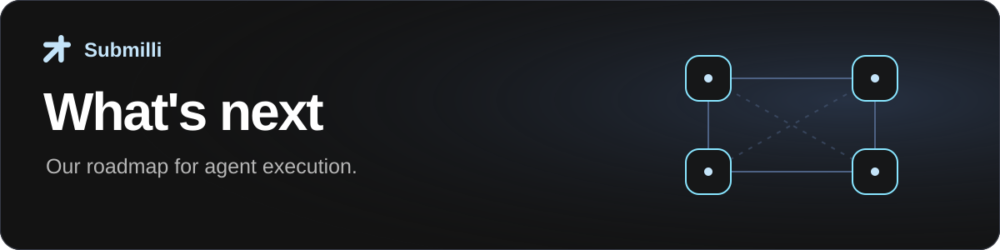

# Roadmap

We want agents to carry out longer tasks, recover when things go wrong, and get cheaper, faster, and more predictable the more they run. These are four areas we plan to build in Submilli.

| [Durability](#durability) | [Submilli Registry](#submilli-registry) | [Self-improving business agents](#self-improving-business-agents) | [Managed cloud](#managed-cloud) |
| :--- | :--- | :--- | :--- |
| Continue after a fix | Discover and share Packages | Run known flows without tokens | Run without managing servers |

> [!NOTE]
> **Planned direction, no fixed dates.** Scope and order may change. The planned examples below describe intended behavior. See the [documentation](https://submilli.ai/docs/) and [release notes](https://github.com/submilli/submilli-runtime/releases) for what is available today.

---

## Durability

**Continue a program after the agent fixes its code.**

Since v0.5.0, agent runs survive server crashes and restarts, and finished steps are not repeated. See [run recovery](https://submilli.ai/docs/reference/run-recovery/). Next, we want an agent to recover from its own errors.

**Example:** An agent's code fails with an error partway through a task. The agent fixes the code and continues execution from the point of failure, preserving completed work instead of starting over.

We also plan safe retry of interrupted Git and code operations.

External effects need explicit recovery rules: when a service's response is lost, the runtime must distinguish a completed action from one whose outcome is unknown.

---

## Submilli Registry

**Discover, publish, and install Submilli Packages in one place.**

We plan Submilli Registry, a public registry for [Packages](https://submilli.ai/docs/packages), similar to npm. Package authors could publish versioned releases, and developers could find integrations and reuse them in their agents.

**Example:** A developer publishes a Package for a billing API. Another team finds it in the registry, checks its documentation and capabilities, and installs a specific version in their project. Their [Blueprint](https://submilli.ai/docs/blueprints) controls which operations the agent can use.

---

## Self-improving business agents

**Run known flows as code, and call a model only for new cases.**

An agent solves tasks by writing code. We plan to keep the code that works and turn it into reusable utilities. For each incoming case, the agent would pick the right utility and run it as deterministic code, without spending tokens. It would fall back to a model only for new cases outside its known flows. The more the agent runs, the more flows it could run as code, so it would get cheaper, faster, and more predictable.

**Example:** A support agent answers refund requests. A model writes the code for the first ones. Later requests of the same kind run that code directly, and a request that matches no known flow goes to the model.

---

## Managed cloud

**Run Submilli without operating the servers yourself.**

We plan a hosted service alongside the open source runtime, with a free tier and managed operation, scaling, and support.

The goal is to take the Blueprints and Packages you use locally into a hosted environment, while keeping permissions and resource limits under your control.

---

## Shipped

### Ask human

**Pause for a person's approval, then continue.**

Since v0.6.0, a [Blueprint](https://submilli.ai/docs/blueprints) rule with the `ask-human` or `ask-admin` action pauses the matching call until the person in the conversation, or an administrator, decides. An approval applies to that one call. A refusal leaves the call unexecuted, and so does a wait that times out. A server with its audit trail on records each decision.

Approvals work for runs over the HTTP session API and in `submilli run` at a terminal. Some calls cannot wait and are denied instead, including calls in runs over MCP or `POST /v1/execute`, and `git.*` calls. See [permissions](https://submilli.ai/docs/reference/permissions/) for the full list.

**Example:** A Blueprint can allow small refunds automatically and require approval for larger ones.

Next, we want an agent to ask a person for missing information and continue with the answer.

---

## Help shape the work

Tell us which planned area would help you ship, and what you need it to do. Share a use case in a [GitHub issue](https://github.com/submilli/submilli-runtime/issues) or join us on [Discord](https://discord.gg/VphpukeGGj).
